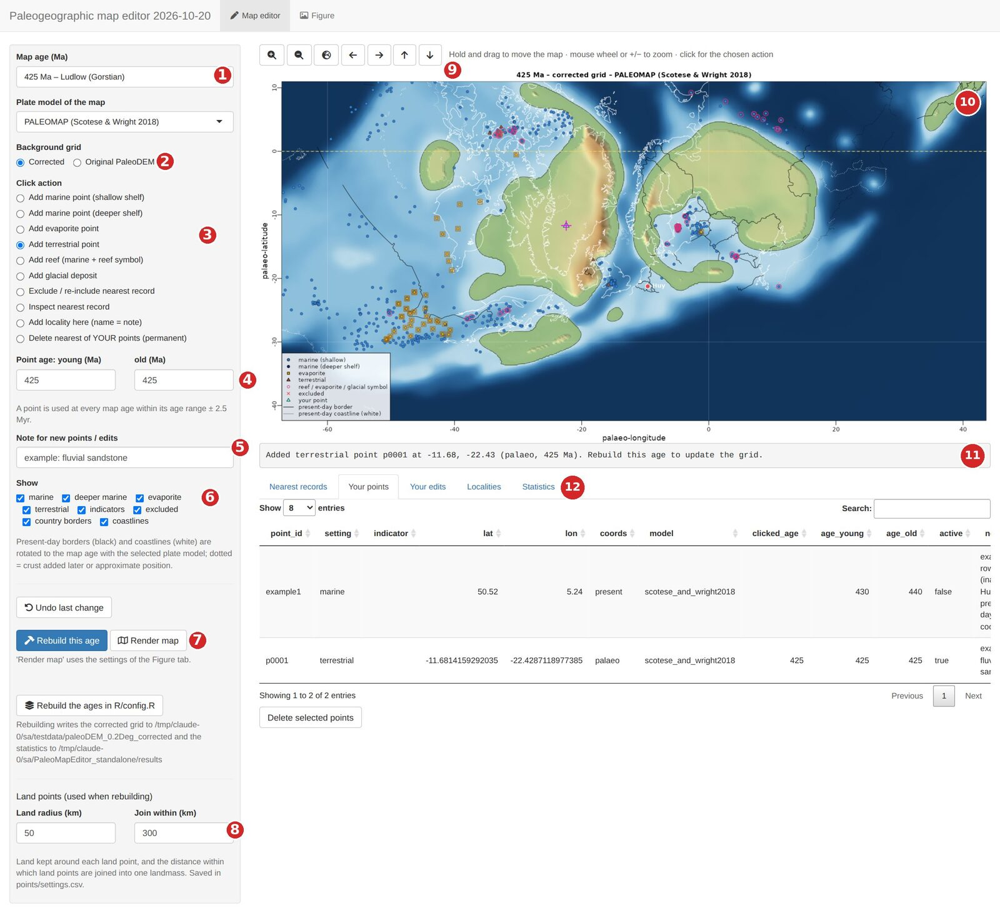
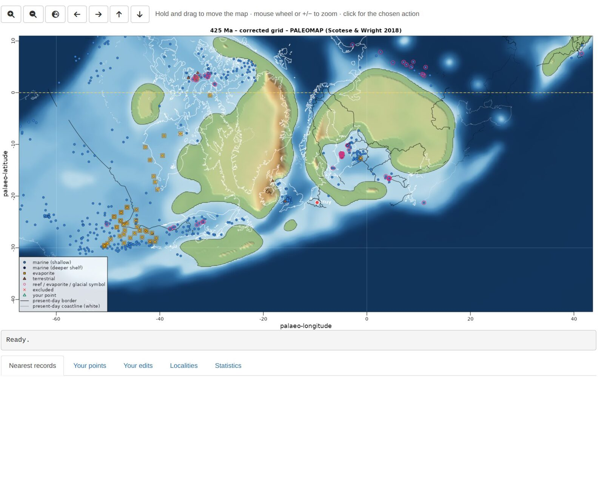
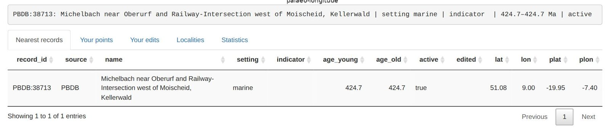
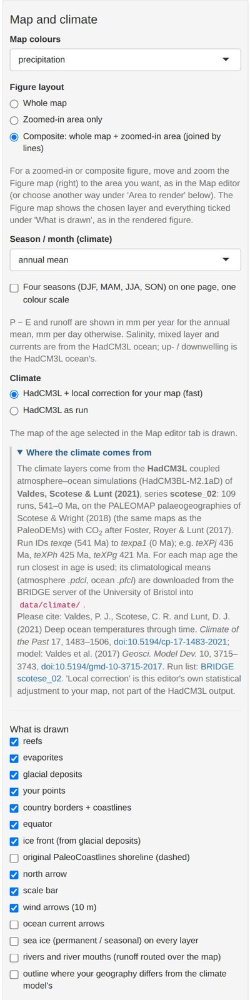
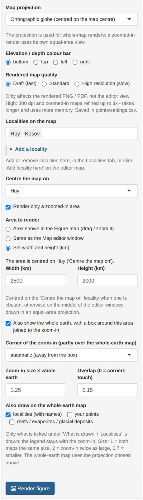
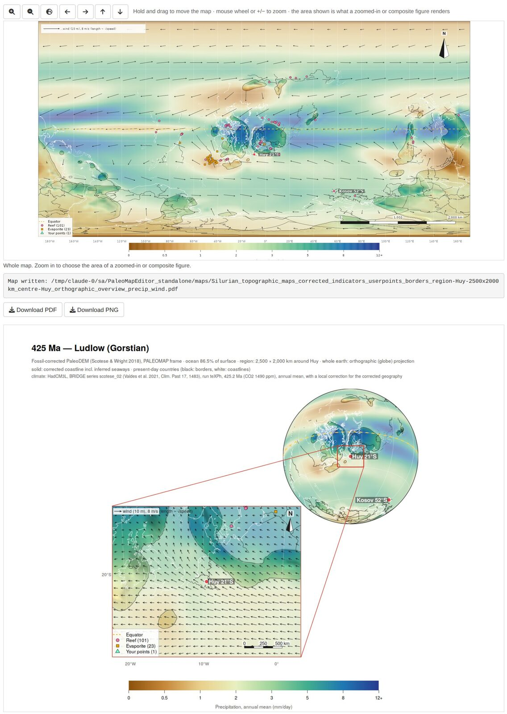

```{r, include = FALSE}
knitr::opts_chunk$set(eval = FALSE)
```

PaleoMapR lets you check a paleogeographic map against the fossil and rock record, correct it, and draw
publication maps of the result, optionally coloured by climate. This guide goes from the installation to a
composite figure of a study area. The screenshots show the Silurian (425 Ma, Ludlow) around Avalonia and Baltica.

## 1. What you need

| | |
|---|---|
| **R** | version 4.2 or newer, <https://cran.r-project.org> |
| **Internet** | once, for the setup (R packages, Python and about 1 GB of open data), and for ages outside 445–415 Ma the first time you open them |
| **Disk space** | about 2 GB (data ~650 MB after the setup; R packages and Python 0.5–1 GB) |
| **Python** | not needed beforehand: the setup downloads its own small Python with pyGPlates |

## 2. Install and set up (once)

**Windows, with the launcher.** Install R, download
[PaleoMapR-launcher.zip](https://github.com/stratigraphy/PaleoMapR/releases/latest/download/PaleoMapR-launcher.zip),
unzip it to a folder with a short, simple path (for example `Documents\Apps`; avoid OneDrive or Dropbox folders),
and double-click **SETUP.bat**. It installs PaleoMapR, puts a **PaleoMapR** icon on the desktop and prepares the
data in the unzipped `PaleoMapR` folder, which is your working folder. Start the editor with the icon.

**From R (Windows, macOS, Linux).**

```{r}
install.packages("remotes")
remotes::install_github("stratigraphy/PaleoMapR")
PaleoMapR::pm_setup("D:/Maps/PaleoMapR")    # once, 20-60 minutes
PaleoMapR::run_app("D:/Maps/PaleoMapR")     # every time
```

Without a folder, both use `pm_folder()`: a folder `PaleoMapR` in your home folder (Documents on Windows).

The setup:

1. makes a small Python environment with pyGPlates (plate rotations) using the tool *uv*, which downloads Python
   3.12 itself. It is stored in your R user-data folder (Windows:
   `C:\Users\<you>\AppData\Roaming\R\data\R\paleomapeditor\venv`) and shared by all working folders;
2. downloads into `data/` the PaleoDEMs 0–540 Ma (~280 MB, EarthByte), the PaleoCoastlines (~75 MB, Zenodo),
   the PBDB and Macrostrat records and the sea-level curve, and builds the table of database records;
3. downloads the HadCM3L climate files of the chosen ages (~30 MB per age, University of Bristol);
4. builds the fossil-corrected grids of the chosen ages (1–2 minutes per age per core; the plate model is
   downloaded once into `models/`).

If a download fails or is interrupted, run the setup again: finished steps and files are kept.

**Which ages?** By default the Silurian ages 445–415 Ma (about 30 minutes). `pm_setup(ages = "all")` prepares all
109 ages, 0–540 Ma (several hours, ~3 GB of climate files); `pm_setup(ages = c(300, 305, 310))` or
`seq(250, 200, by = -5)` your own (each matched to the nearest map age). With the launcher, run
`SETUP.bat all` or `SETUP.bat 300 305 310` from a command window. Any age also works directly in the editor:
choose it and press **Rebuild this age**.

### The working folder

| Folder | Content |
|---|---|
| `data/` | the downloaded data sets and HadCM3L climate files; the corrected grids (`data/paleoDEM_0.2Deg_corrected`) |
| `models/` | plate models, downloaded when first used (PALEOMAP; the others when you choose them) |
| `points/` | your work: your points, record edits, localities and settings (section 4.6); the table of database records |
| `maps/` | rendered figures (PNG and PDF) |
| `results/` | statistics of the corrected grids |

## 3. The screen at a glance



| # | Control | # | Control |
|---|---|---|---|
| 1 | Map age (all PaleoDEM ages, Silurian first) and plate model | 7 | Rebuild this age (corrected grid) and Render map |
| 2 | Background grid: corrected or original PaleoDEM | 8 | Land points: radius and joining distance |
| 3 | Click action: what a short click on the map does | 9 | Zoom in and out, whole map, move |
| 4 | Age range given to new points | 10 | The map: drag to move, wheel to zoom, click to act |
| 5 | Note stored with new points and edits | 11 | Status line: what just happened, what to do next |
| 6 | Show: which records and overlays are drawn | 12 | Tables: nearest records, your points, your edits, localities, statistics |

Symbols on the editor map: blue circles = marine (dark blue: deeper shelf), orange squares = evaporites, brown
triangles = terrestrial, pink rings = reef, evaporite or glacial indicator, red crosses = excluded, green
triangles = your points, magenta cross = the last point you clicked. Black lines are present-day borders and
white lines present-day coastlines, rotated to the map age (dotted: crust that formed later or is uncertain).

## 4. Map editor: checking and correcting a map

### 4.1 Look around

* Choose the **map age** (1). The list holds every PaleoDEM age from 0 to 540 Ma; the ages prepared by the setup
  have corrected grids. For other ages choose **Original PaleoDEM** (2) until you have rebuilt them.
* **Move:** hold the left mouse button and drag. **Zoom:** mouse wheel (around the cursor) or the +/− buttons
  (9). The globe button goes back to the whole map.
* Use **Show** (6) to hide classes of records, for example untick *marine* to see the terrestrial records better.



### 4.2 Inspect a record

Set the click action to **Inspect nearest record** and click on a symbol. The status line and the **Nearest
records** table show the record: its ID (PBDB collection number, or MS: Macrostrat unit), name, setting, age range,
present-day and palaeo-coordinates.



### 4.3 Add your own points

1. Set the **age range** (4) of the point. A point is used at every map age within its range ± 2.5 Myr; by
   default it is the current map age.
2. Optionally type a **note** (5), such as the formation or the reference. It is stored with the point.
3. Choose the click action (3) and click on the map where the record is:

| Click action | Effect when the grid is rebuilt |
|---|---|
| Add marine point (shallow shelf) | the area around it becomes shallow sea (about −30 m) |
| Add marine point (deeper shelf) | deeper shelf (−400 m by default), blending into the surrounding shelf; not deep ocean |
| Add evaporite point | sea at or just below sea level (−5 m) |
| Add terrestrial point | kept as land: a rounded patch (*Land radius*, 50 km) joined to nearby land (*Join within*, 300 km); near such points the original PaleoDEM relief is restored where the map is land again |
| Add reef / Add glacial deposit | a marine point with a reef symbol / a glacial-deposit symbol (glacial deposits do not decide land or sea) |
| Add locality here (name = note) | a named locality for the figures (type the name in the Note box first) |

Points clicked on the palaeo-map are stored with their plate, so they move with it at other ages. The **Your
points** table lists them; select rows and press **Delete selected points**, or use the click action **Delete
nearest of YOUR points**. **Undo last change** reverts the last addition or edit.

### 4.4 Switch off wrong database records

Choose **Exclude / re-include nearest record** and click on a record: it gets a red cross and is ignored when the
grid is rebuilt. Click it again to include it again. All exclusions are listed under **Your edits**, where you can
remove them. Use this for records that are clearly mislocated or misclassified (check them with Inspect first).

### 4.5 Rebuild the corrected grid

Your points and edits only change the map after a rebuild. Press **Rebuild this age** (7): it takes about a
minute, and the status line reports the records used, the seaways added, the seas still isolated (should be 0) and
the ocean area. **Rebuild the Silurian ages** rebuilds 445–415 Ma at once on several cores. The **Statistics** tab
lists the results of all rebuilt ages. Then switch the background grid to **Corrected** to see the new map.

**Land points** (8): *Land radius* is the land kept around each terrestrial point, *Join within* the distance
within which terrestrial points are joined into one landmass (and to existing land). Larger values give larger,
smoother landmasses. Both are saved and used at the next rebuild.

### 4.6 Where your work is stored

Everything is a plain CSV file in `points/`: you can open, edit or share them. To share your corrections, send
`user_points.csv` and `record_edits.csv` to a colleague, who copies them into their own `points/` folder and
rebuilds.

| File | Content |
|---|---|
| `user_points.csv` | your points: setting, indicator, lat, lon, present or palaeo coordinates, age range, active, note |
| `record_edits.csv` | database records you excluded, re-included or re-classified |
| `localities.csv` | named localities (present-day lat/lon) and whether they are shown |
| `settings.csv` | settings changed in the editor: projection, quality, colour bar, land points |
| `records_base.csv` | the database records (PBDB and Macrostrat); rebuilt automatically when needed |

Close a CSV file in Excel before you continue in the editor: Excel locks the file, and the editor then cannot save
your change (it says so in the status line).

## 5. Figure tab: making maps

The Figure tab has the settings of the rendered maps on the left, an interactive **Figure map** on the right (it
shows the chosen layer and overlays; move and zoom it to choose the area of zoomed-in figures) and the rendered
figure below it, with download buttons. **Render map** in the Map editor uses the same settings.

<div style="display:flex; gap:12px; align-items:flex-start">


<div style="width:52%">

* **Map colours:** topography or a climate layer: precipitation, near-surface air temperature (brought to the map
  heights with a lapse rate), precipitation − evaporation, runoff, freshwater into the sea (P − E plus rivers
  routed over your map), river water, why the sea is fresher or saltier, sea-surface salinity, up- and
  downwelling, mixed-layer depth, surface O<sub>2</sub> saturation, surface density, sea ice.
* **Figure layout:** whole map, zoomed-in area only, or composite (whole earth and zoom-in, joined by lines).
* **Season / month:** annual mean, DJF, MAM, JJA, SON or one month; *Four seasons* puts DJF–SON on one page with
  one colour scale.
* **Climate:** *HadCM3L + local correction* adjusts the model fields to your corrected geography (land fraction
  around each point, sea upwind, relief, height), learned from the same model run; *HadCM3L as run* shows the
  model unchanged.
* **What is drawn:** reefs, evaporites, glacial deposits, your points, borders and coastlines, equator, ice front,
  the original PaleoCoastlines shoreline, north arrow, scale bar, wind and current arrows, sea ice, rivers, and a
  dashed outline where your geography differs much from the model's (least reliable climate).
* **Projection** (whole maps): Mollweide, Robinson, Equal Earth, Winkel tripel, Hammer, Eckert IV, Plate Carrée,
  orthographic globe, south or north polar. Zoomed-in areas use their own equal-area projection.
* **Quality:** draft (150 dpi, fast), standard (220 dpi), high (300 dpi, zoom-ins refined up to 8×, slow).
* **Localities:** which are labelled (with their palaeo-latitude); centre the map on a locality (it then follows
  the locality through time) or on a longitude.

</div>
</div>

**Render figure** writes a PNG and a vector PDF to `maps/` and shows the result; **Download PDF / PNG** saves a
copy where you want. In the PDF every label and line is a separate, editable object (Illustrator, Inkscape,
Affinity); only the shaded relief is an image.

### 5.1 Recipe: a composite figure of your study area

1. In the Map editor, choose the age and make sure the area is corrected the way you want (section 4); rebuild if
   needed.
2. In the Figure tab, choose the **Map colours** (for example precipitation) and the season.
3. Under **Figure layout**, choose **Composite**.
4. Centre the map on your locality and, under **Area to render**, choose **Set width and height (km)** (for
   example 2500 × 2000 km), or move and zoom the Figure map to the area and keep *Area shown in the Figure map*.
5. Choose the whole-earth projection (for example the orthographic globe) and tick north arrow, scale bar and wind
   arrows as you like.
6. Press **Render figure**: draft quality first, high for the final version.



## 6. Using the code from R

All steps behind the editor can be run from a script:

```{r}
pm <- PaleoMapR::pm_load("D:/Maps/PaleoMapR")
pm$run_dem_correction(c(430, 425))                        # corrected grids
pm$make_maps(425, layer = "precipitation", wind = TRUE)   # PNG and PDF in maps/
pm$SILUCARB$ages                                          # the settings, e.g. the default ages
```

The settings (correction parameters, default ages, map look) are in the list `pm$SILUCARB`; their defaults and
explanations are in `inst/app/R/config.R` of the package source.

## 7. Problems {#problems}

| Problem | Solution |
|---|---|
| "No corrected grid for … Ma yet" | Press **Rebuild this age**, or choose **Original PaleoDEM** as background grid. |
| My new points do not change the map | Rebuild the age (4.5) and choose the **Corrected** grid. Check that the point's age range covers the map age (± 2.5 Myr) and that it is active. |
| "Could not save … – the file is locked" | A CSV in `points/` is open in Excel (or read-only). Close it and try again. |
| The setup ends with "Not complete yet: …" | A download failed (server busy or connection lost). Run the setup again: finished steps are skipped and only the missing parts are fetched. |
| The climate layer is empty / "could not be downloaded" | Ages outside the prepared ones need internet the first time. The files are kept afterwards. |
| The editor does not open in the browser | From R, look in the console for the address (http://127.0.0.1:…) and open it by hand. With the launcher, see `state/setup_log.txt`. |
| Python / pyGPlates errors at the start | Restart R and run `pm_setup()` (or SETUP.bat) again. To start Python from scratch, delete the `paleomapeditor\venv` folder named in section 2. If uv fails, the setup tries a conda environment "paleomap". |
| A package fails to install | Update R and run the setup again. On Linux, sf and terra need the GDAL, GEOS, PROJ and udunits system libraries. |
| Corporate network or proxy | The setup needs cloud.r-project.org, github.com, pypi.org, earthbyte.org, zenodo.org, paleobiodb.org, macrostrat.org and paleo.bristol.ac.uk. Ask IT, or run the setup once on another network. |
| Rendering is slow | Use *draft* quality while trying settings; *high* only for the final figure. |
| Start again with an empty map | Close the editor, move the files in `points/` except `records_base.csv` to another folder, start the editor and rebuild. |

Anything else: [open an issue](https://github.com/stratigraphy/PaleoMapR/issues/new/choose) or ask in the
[Discussions](https://github.com/stratigraphy/PaleoMapR/discussions).
